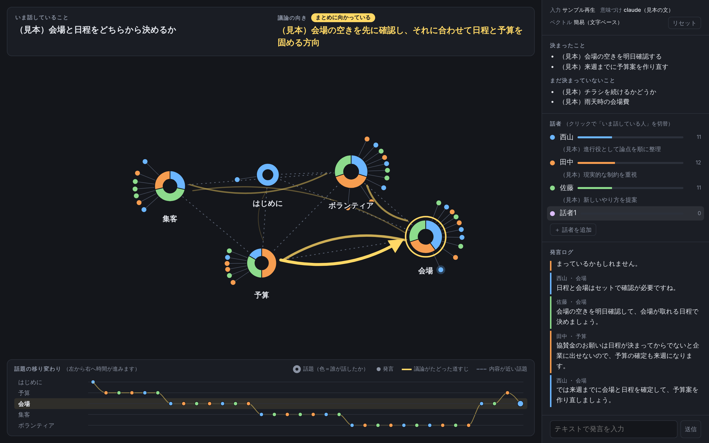

# 会話マップ

リアルタイムの会話を「話題の地図」として表示する、MacBook 上で動く試作です。



（画像の「（見本）」と付いた文は、表示確認のために入れた仮の文です。実際は Claude が会話から作ります。）

- **上の帯**：いま話していることと、議論全体がどこへ向かっているか。
- **地図**：大きな円が話題、まわりの小さな点が発言です。色は話者で、円の色の割合は「その話題を誰がどれだけ話したか」を表します。
- **黄色い線**：議論がたどった道すじ。新しい移動ほど太く濃く、最後の1本に矢印が付きます。黄色い輪がいまの話題です。
- **下の帯**：話題の移り変わり。行が話題、左から右へ時間が進みます。
- **右**：決まったこと、まだ決まっていないこと、各話者のスタンス、発言ログ。
- 話題をクリックすると、その話題の発言だけを表示します。

## しくみ

| 処理 | 場所 |
|---|---|
| マイク入力・文字起こし（Whisper） | Mac の中 |
| 発言のベクトル化・話題への振り分け | Mac の中 |
| 話題の名前・要約・各人のスタンス | Claude（テキストだけを送信） |

音声は外に出ません。Claude に送るのは文字起こし後のテキストだけです。
API キーがなくても動きますが、その場合は話題名が発言の冒頭になり、要約は出ません。

## 動かし方

```bash
cd kaiwa-map
python3 -m venv .venv && source .venv/bin/activate
pip install -r requirements.txt

# まずはマイクなしでサンプル会話を再生
python app.py --demo

# マイクで使う（初回はモデルのダウンロードで数分かかります）
export ANTHROPIC_API_KEY=...   # Claude による意味づけを使う場合
python app.py
```

ブラウザで http://localhost:8765 を開きます。初回のマイク利用時に、ターミナルへのマイク許可を求められます。

### オプション

| 指定 | 内容 |
|---|---|
| `--demo` | サンプル会話（`sample/demo.txt`）を再生 |
| `--no-mic` | マイクを使わず、画面のテキスト入力だけで使う |
| `--threshold 0.5` | 同じ話題とみなす近さ。大きいほど話題が細かく分かれる（既定 0.45） |
| `--embed hash` | ベクトル化モデルを使わない簡易版 |
| `--device 名前か番号` | 入力デバイスを指定 |
| 環境変数 `KAIWA_MODEL` | 意味づけに使う Claude のモデル（既定 `claude-haiku-5-5`） |

発言ログは `logs/` に JSONL で保存されます。

## いまの制限

- 話者の区別は自動ではありません。右パネルの話者をクリックして「いま話している人」を切り替えます。
- 入力はマイクだけです。オンライン会議の相手側の音声（Mac のシステム音声）は未対応です。
